# Spindle

Spindle puts a turntable on your Mac's desktop. The scene sits between your wallpaper and
your desktop icons, so it isn't a window and you can't click it. Whatever you play shows up
as the record: the album art is printed on the sleeve and on the spinning label.

[**Download Spindle for macOS (.dmg)**](https://github.com/likeharvey17-art/spindle/releases/latest/download/Spindle.dmg)

Requires macOS 14 or later.

| Golden Hour | Lamplight |
| --- | --- |
| 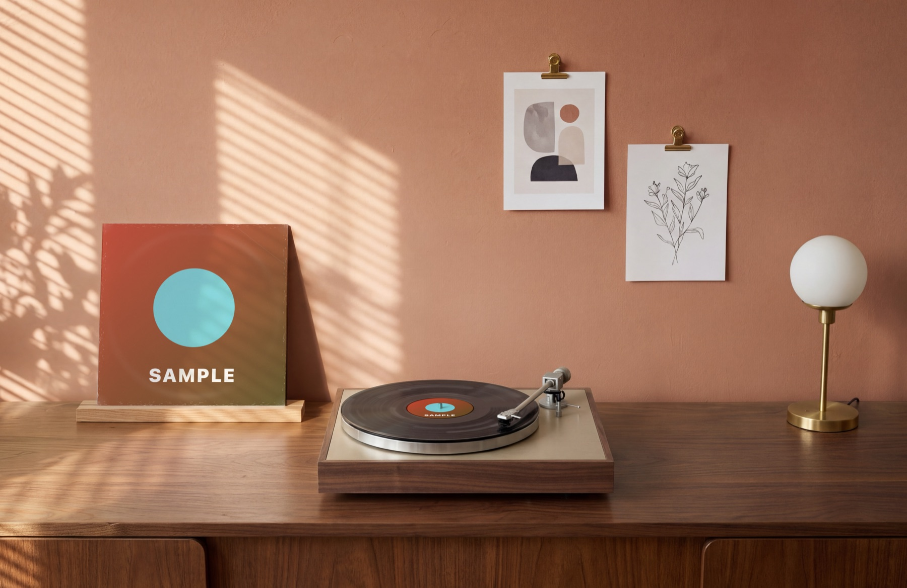 | 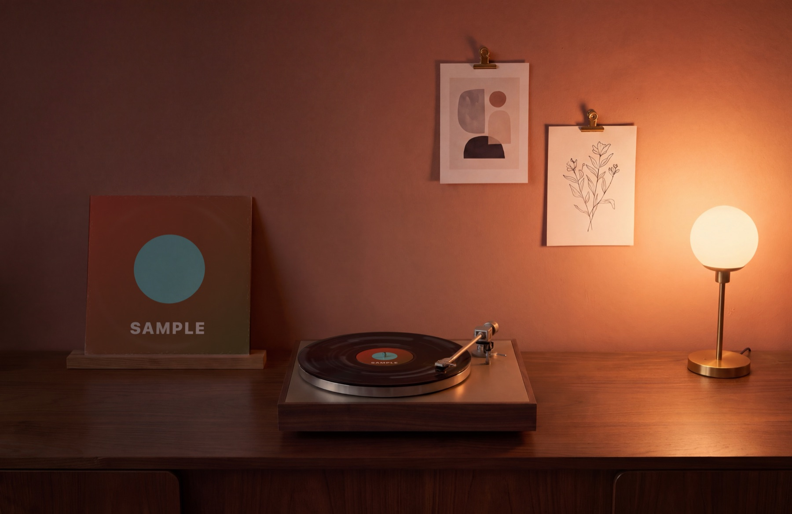 |
| Overhead | Midnight |
| 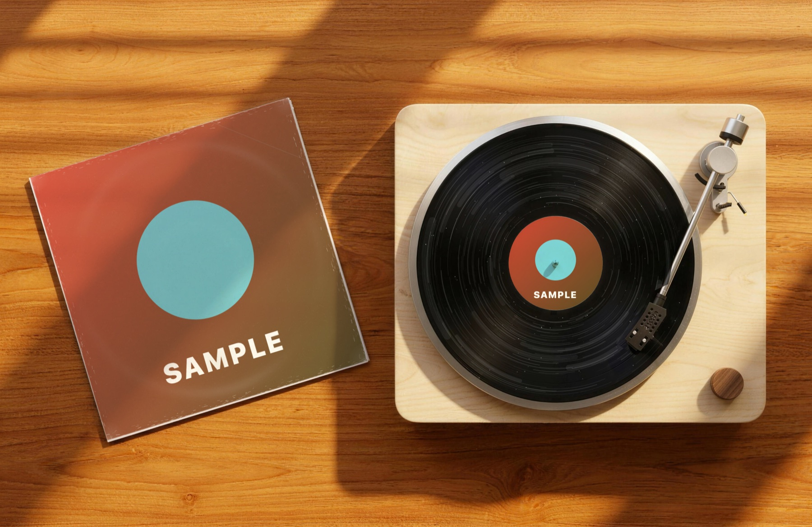 | 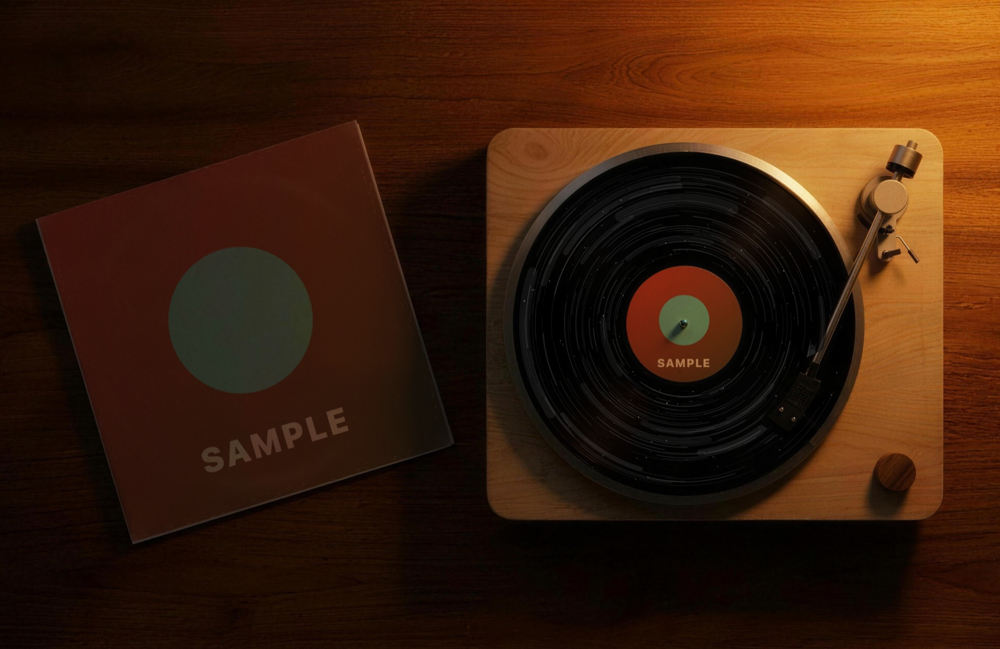 |

## What it does

Spindle has four scenes: Golden Hour, Lamplight, Overhead and Midnight. They are photoreal
images, and the album art is relit to match the light in each room. When the track changes,
the old record slides out of the sleeve and the new one slides in.

It reads Spotify, Apple Music and Swinsian directly. Other players, including browsers, come
through the system Now Playing feed. If a player gives no artwork, Spindle looks it up in the
iTunes catalog.

Spindle only reads playback. It never sends play, pause or skip, so it won't get in the way
of other controllers. The steady spin runs on Core Animation and uses about 0.5% CPU, and
nothing is drawn while the music is paused.

The menu-bar panel is styled like a 1970s receiver. It has a scene knob, a VU meter that
follows your Mac's audio, a Wide / Mid / Close framing switch, a toggle to hide desktop icons
and widgets, launch at login, a choice of music source, and the widget controls. There is no
Dock icon.

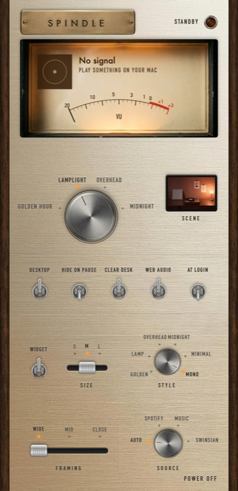

## Widgets

Turn on **Widget** in the panel for a small turntable you can drag anywhere on the desktop. It
sits above your icons and below your windows, spins with the music and remembers where you
leave it. Pick a size (small is the size of a small macOS widget) and a style:

| Golden | Lamp | Overhead | Midnight |
| --- | --- | --- | --- |
| 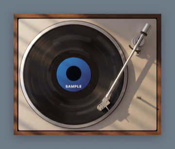 | 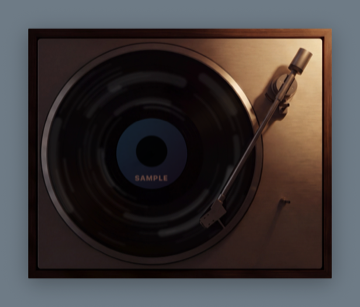 | 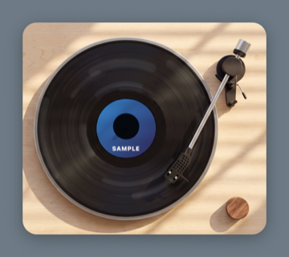 | 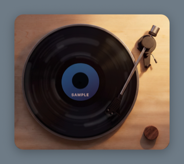 |
| **Minimal** | **Mono (Light mode)** | **Mono (Dark mode)** | |
| 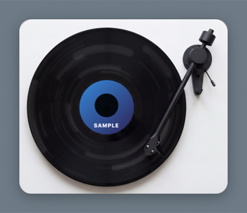 | 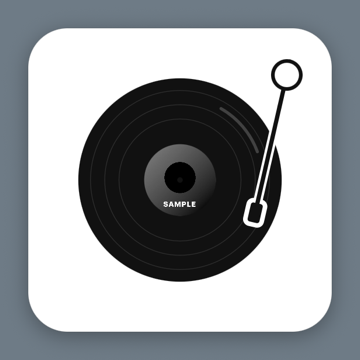 | 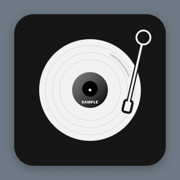 | |

The first five are photographs of the turntable, cut out along its own edge. Mono is a flat
black-and-white drawing on a square card that follows your Mac's Light and Dark mode, so it
fits any wallpaper. Its label shows the album art in grayscale.

## Install

Download the DMG above, open it and drag Spindle to Applications.

The app is ad-hoc signed but not notarized, so macOS blocks it the first time. Open System
Settings > Privacy & Security, scroll down and choose Open Anyway. You only need to do this
once.

macOS asks for permission the first time Spindle talks to Spotify, Music or Swinsian, and the
first time the VU meter listens to system audio. The meter only measures loudness and records
nothing.

## Build from source

You need the Xcode command line tools with a Swift 6 toolchain.

```bash
./build.sh            # builds build/Spindle.app
./build.sh --install  # also copies it to /Applications
./build.sh --dmg      # also packs dist/Spindle.dmg
```

## Your own scenes

The four scenes ship inside the app. To replace one, put your own `<name>.png` (or `.jpg`) and
`<name>.json` in `~/Library/Application Support/Spindle/Scenes/`. Files there win over the
bundled ones. The names are `listening-room`, `after-hours`, `turntable` and `overhead-night`.

A scene is one photo with a blank white sleeve and a record with a blank white label. The JSON
gives their positions in image pixels, so the art can be laid on with the photo's own
perspective:

```json
{
  "width": 1312,
  "sleeve": [[x,y], [x,y], [x,y], [x,y]],
  "label":  {"cx": 0, "cy": 0, "rx": 0, "ry": 0},
  "record": {"cx": 0, "cy": 0, "rx": 0, "ry": 0},
  "arm":    [[x,y], ...],
  "focus":  [x, y]
}
```

The sleeve corners run top-left, top-right, bottom-right, bottom-left. `record` is the vinyl's
outer oval. `arm` outlines the tonearm where it crosses the record, which keeps the spinning
glints off it. `width` is the image width the coordinates were measured at. Widget photos in
`Resources/Widgets` use the same format, plus `image`, `crop` (the turntable's outline as x, y,
width, height) and `corner` (its corner radius).

## Development

`Spindle --snapshot <turntable|listeningRoom|afterHours|overheadNight> out.png [wide|mid|close]`
renders a scene offscreen with sample artwork, so you can check visuals without the desktop.
`Spindle --card <style> <small|medium|large> out.png` renders a widget, and
`Spindle --panel out.png` renders the settings panel.

| Path | What's in it |
| --- | --- |
| `Sources/Vinyl/NowPlaying/` | System Now Playing monitor, player AppleScript, artwork lookup |
| `Sources/Vinyl/Scene/` | Photo scene compositing, spin motion, framing |
| `Sources/Vinyl/Widgets/` | The desktop widget window, sizes and the Mono drawing |
| `Sources/Vinyl/Rendering/` | Procedural textures and the app icon |
| `Sources/Vinyl/App/` | App lifecycle, desktop window, menu bar, settings |
| `Sources/Vinyl/UI/` | The SwiftUI settings panel and VU meter |
| `Resources/Scenes/` | The four scene photos and their calibration |
| `Resources/Widgets/` | The widget photos and their calibration |
| `Resources/Panel/` | Cut-out parts for the settings panel |
